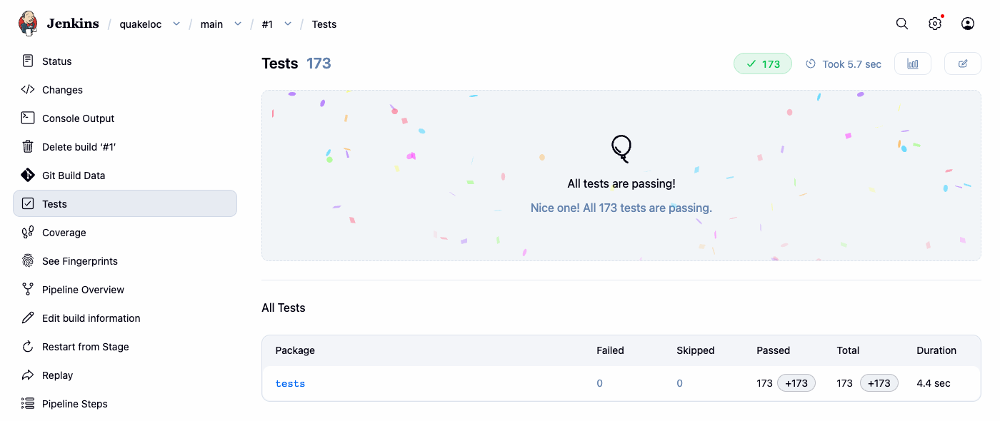
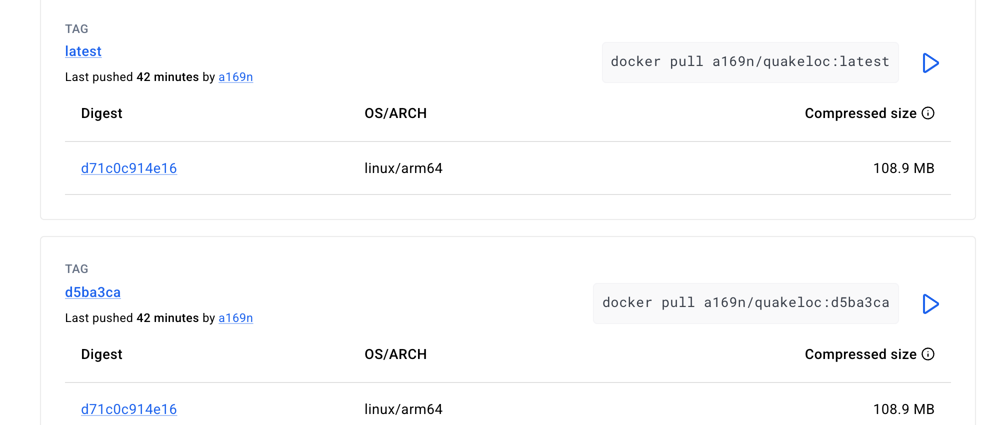
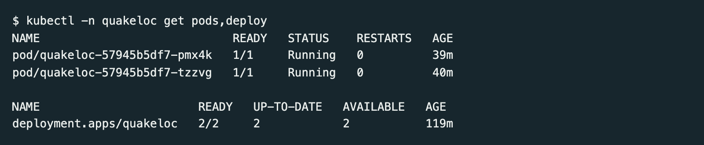
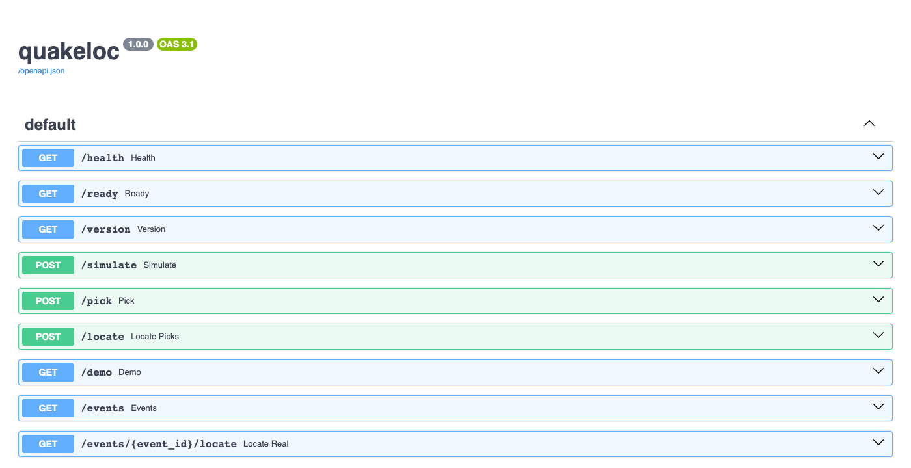
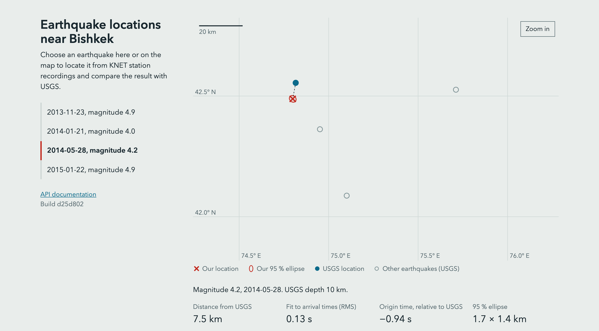
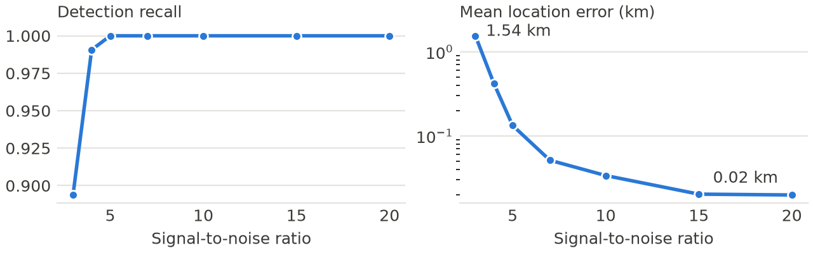

# 1. Project and links

quakeloc detects earthquakes (STA/LTA), picks P-wave onsets (AIC) and locates epicentres with 95 % error ellipses (Geiger's method). It is a FastAPI service validated on synthetic data and on a frozen snapshot of the KNET network near Bishkek. Repository: <https://github.com/a169n/applied_5>. Pipeline: [Jenkinsfile](https://github.com/a169n/applied_5/blob/main/Jenkinsfile). Image: <https://hub.docker.com/r/a169n/quakeloc>. Steps to reproduce: [docs/RUNBOOK.md](https://github.com/a169n/applied_5/blob/main/docs/RUNBOOK.md).

# 2. Steps

**Docker.** A multi-stage `Dockerfile` has separate `test`, `artifacts`, `data` and `runtime` targets. The runtime image contains no compilers or test tools and runs as a non-root user. It is 516 MB locally and 108.9 MB compressed on Docker Hub. A build fails if its calibration artifacts differ from those the tests validated.

**Jenkins.** Jenkins runs in Docker and is configured entirely from the repository (Configuration as Code and Job DSL), so one command recreates it. A multibranch job scans GitHub every 2 minutes, because a local Jenkins cannot receive webhooks. The ten stages are checkout, test image, lint, unit and property tests, scientific validation, real-data validation, runtime image, container smoke test, Docker Hub push and Minikube deploy. The last two run only on `main`. A separate job refreshes the data and never pushes; its first run fetched files identical to the committed snapshot.

**Git and automation.** Work reached `main` through a pull request, and every build and test stage has a `make` target with the same command, so CI failures can be reproduced locally.

**Deployment (bonus).** Stage 10 deploys the image tagged with the commit SHA to Minikube, runs a smoke Job inside the cluster and rolls back on failure. I tested the rollback manually. The service also serves a small web client at `/`, where a user picks an earthquake and compares our location with USGS.

# 3. Results

**Green run.** `main` build #1 passed all stages in 2 min 23 s (Figure 1) with 173 tests passing (Figure 3). `/version` in the cluster returned the SHA of `main` HEAD, `d5ba3ca`.

{width=17cm}

**Red run.** Branch `demo/broken-locator` negates one column of the location Jacobian. Stage 4 failed with 47 of 162 tests failing, including `test_noise_free_exact_inversion` (Figure 2). Nothing was pushed or deployed: Docker Hub and the cluster stayed on `d5ba3ca`. This branch is never merged.

{width=17cm}

**Delivery.** The image reached Docker Hub under its commit SHA and `latest` (Figure 4), and the cluster runs two ready replicas (Figure 5). The API is documented at `/docs` (Figure 6). The web client (Figure 7) was added after build #1, so that capture is a local run of the commit that adds it.

+-------------------------------------------------+-------------------------------------------------+
| {width=7.8cm}     | {width=7.8cm}    |
|                                                 |                                                 |
| Figure 3. Test report, `main` build #1.         | Figure 4. Docker Hub tags.                      |
+-------------------------------------------------+-------------------------------------------------+
| {width=7.8cm}      | {width=7.8cm}          |
|                                                 |                                                 |
| Figure 5. `kubectl get pods,deploy` output.     | Figure 6. API documentation at `/docs`.         |
+-------------------------------------------------+-------------------------------------------------+
| {width=7.8cm}        | {width=7.8cm}         |
|                                                 |                                                 |
| Figure 7. Web client, local run.                | Figure 8. Synthetic SNR sweep, seed 42.         |
+-------------------------------------------------+-------------------------------------------------+

**Science.** On synthetic data, recall rises from 0.89 at SNR 3 to 1.0 at SNR 5 and above, and mean location error falls from 1.54 km to 0.02 km (Figure 8). On real data all 4 events locate, at 2.8, 7.5, 12.2 and 18.3 km from the USGS epicentres (one response in Figure 9). Four events are a demonstration, not a statistical validation. The ellipses cover pick scatter only, so the USGS epicentre often lies outside them.

{width=17cm}

# 4. Difficulties

- **Sparse real data.** EarthScope returned no KN waveforms for much of the catalog period, so only 4 events qualified and lowering the magnitude limit to 3.5 added none. I kept the 4 events and stated the limit instead of tuning the results.
- **Stale artifacts.** The identity check failed locally after `src/` changed, because the artifacts were older than the code. Recalibrating fixed it, and the runbook now lists this case.
- **Jenkins lost its network.** Recreating the container dropped its link to the Minikube network, so `make jenkins-up` now restores it.
- **A test hid failures.** A stub's final `exit 0` masked simulated `kubectl` failures, so a commit went in with two failing tests. The next commit fixed the stub.

# 5. Conclusions

The pipeline turns a merge into a tested, published and deployed service without manual steps, and the red run shows that a scientific bug stops before release. The most useful decision was to test against known answers, since a generic smoke test would not have caught a sign error in the Jacobian. The main limits are the small real-data sample, the one-layer velocity model and a Jenkins instance that runs only on a laptop.

```{=openxml}
<w:p><w:r><w:br w:type="page"/></w:r></w:p>
```

# Appendix A. Technical details

This appendix is reference material. The report itself is pages 1 and 2.

# A.1 Processing chain and API

Waveforms from several stations pass through four steps: STA/LTA detection (`detect.py`), the ratio of a short-term to a long-term average amplitude, which jumps when a wave arrives; AIC onset picking (`pick.py`), which finds the sample that best splits the trace into noise and signal; Geiger's method with Levenberg–Marquardt damping (`locate.py`), which fits the epicentre and origin time to the picked arrival times; and a 95 % error ellipse from the pick scatter.

| Endpoint | Purpose |
|------------------------|--------------------------------------------------|
| `GET /` | Web client: pick an event, compare our location with USGS |
| `GET /docs` | Generated OpenAPI documentation |
| `GET /health` | Process is alive (liveness probe) |
| `GET /ready` | Detector loaded and built-in test earthquake located within 0.5 km (readiness probe) |
| `GET /version` | Commit SHA, build number, artifact and snapshot hashes |
| `POST /simulate`, `/pick`, `/locate` | Individual steps of the chain |
| `GET /demo` | Full run on a synthetic event |
| `GET /events`, `/events/{id}/locate` | Real KNET events and their location |

# A.2 Docker image

| Target | Contents and role |
|-----------|---------------------------------------------------------------|
| `deps` | Pinned dependencies built as wheels; base of every other target |
| `test` | `deps` plus pytest, Hypothesis and Ruff; lint and tests run here, in the shipped environment |
| `artifacts` | Runs the seeded calibration (`--seed 42`) and writes `detector.json` |
| `data` | ObsPy fetch tool for the refresh job; compiles ObsPy from source on arm64 |
| `runtime` | Code, calibration artifacts and the data snapshot only |

The runtime image runs as uid 10001, has a `HEALTHCHECK` on `/health`, and carries OCI labels with the commit SHA, source URL and build date. The build metadata is the last layer, so it never invalidates the cache of the layers above.

# A.3 Jenkins

Jenkins `2.580.2-lts-jdk21` runs from `jenkins/docker-compose.yml`. Its 11 plugins are listed in `jenkins/plugins.txt`; `jenkins/casc.yaml` defines the admin user, the Docker Hub credential and, through Job DSL, the multibranch job with a 2-minute scan. Secrets live in gitignored files.

| # | Stage | Command | Checks |
|----|---------------------|----------------------|---------------------------------|
| 1 | Checkout | `checkout scm` | Computes the commit SHA and image tag |
| 2 | Build test image | `make image-test` | Test image builds |
| 3 | Lint | `make lint` | Ruff lint and format |
| 4 | Unit & property tests | `make test` | pytest and Hypothesis, coverage gate 80 % |
| 5 | Scientific validation | `make calibrate science` | Calibration in two containers is byte-identical; synthetic accuracy |
| 6 | Real-data validation | `make realdata` | 4 KNET events within committed limits; UNSTABLE if the snapshot is missing |
| 7 | Build runtime image | `make image` | Baked calibration equals the tested one |
| 8 | Container smoke test | `make smoke` | `/ready`, `/version`, `/`, `/demo` error under 1 km, `/events` |
| 9 | Push to Docker Hub | `docker push` | `main` only; tags SHA and `latest`; logs out afterwards |
| 10 | Deploy to Minikube | `k8s/deploy.sh` | `main` only; see A.4 |

Stages 9 and 10 run only when the build result is SUCCESS, so an UNSTABLE build never ships. The `post` block always publishes the JUnit report and Cobertura coverage, archives the artifacts and cleans the workspace.

# A.4 Kubernetes deployment

| Manifest | Contents |
|-----------------|-----------------------------------------------------------|
| `namespace.yaml` | Namespace `quakeloc` |
| `deployment.yaml` | 2 replicas; rolling update with `maxUnavailable: 0`, `maxSurge: 1`; liveness on `/health`, readiness on `/ready`; CPU and memory limits; non-root, read-only root filesystem; 5 s `preStop` sleep so a rollout drops no requests |
| `service.yaml` | NodePort service, port 8000, node port 30080 |
| `smoke-job.yaml` | Job that runs `quakeloc.smoke` against the service from inside the cluster |

`k8s/deploy.sh` applies the manifests, waits for the rollout, then runs the smoke Job. If the rollout or the Job fails, it runs `kubectl rollout undo` and fails the build.

# A.5 How to run

```
minikube start --driver=docker --memory=2200mb --cpus=2
make jenkins-up                      # Jenkins at http://localhost:8080
kubectl -n quakeloc get pods,deploy
minikube service quakeloc -n quakeloc --url
```

The full procedure, including the one-time secrets setup, is in `docs/RUNBOOK.md`.
